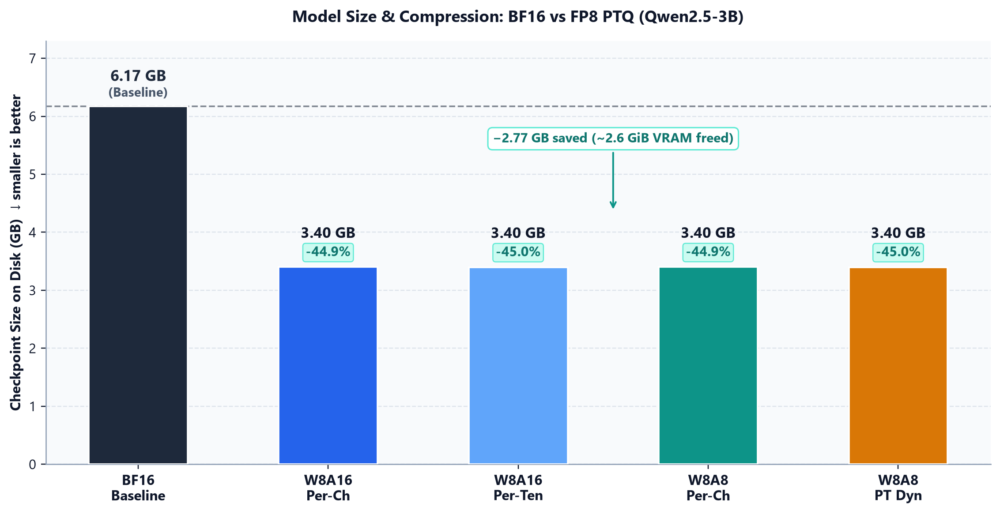
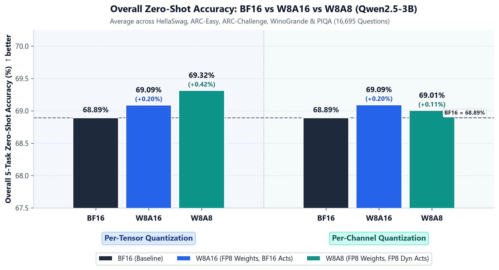
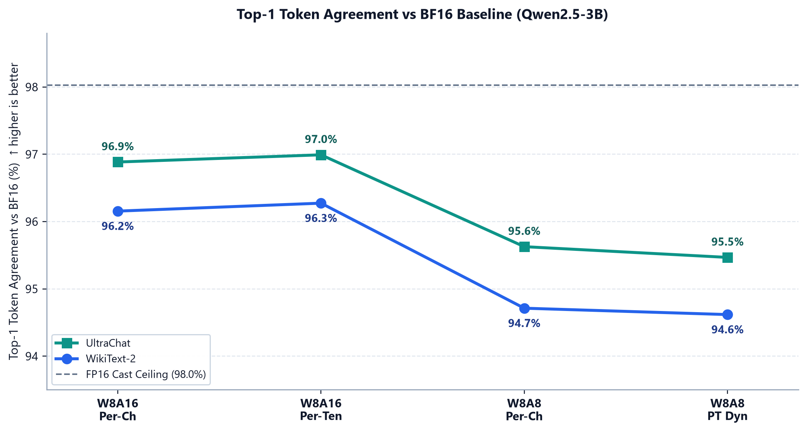
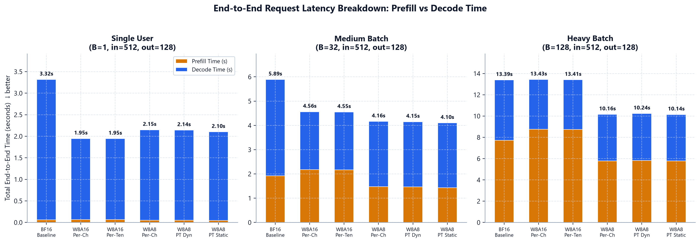
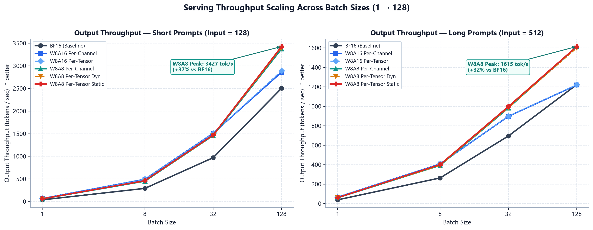

# Qwen2.5-3B FP8 Post-Training Quantization (PTQ) Study

[](https://huggingface.co/UchihaUdhaya/Qwen2.5-3B-FP8-W8A8-Dynamic)
[](https://huggingface.co/Qwen/Qwen2.5-3B)
[](https://www.apache.org/licenses/LICENSE-2.0)
[-76B900)](https://www.nvidia.com/en-us/data-center/l4/)

A rigorous, end-to-end **Post-Training Quantization (PTQ)** benchmark evaluating **5 FP8 E4M3 quantization recipes** on [`Qwen/Qwen2.5-3B`](https://huggingface.co/Qwen/Qwen2.5-3B) using **real `vLLM` serving on an NVIDIA L4 (24 GB Ada Lovelace)** GPU — with **zero fine-tuning, zero LoRA, and zero gradients**.

> **Published Quantized Weights:** Download directly from Hugging Face → **[`UchihaUdhaya/Qwen2.5-3B-FP8-W8A8-Dynamic`](https://huggingface.co/UchihaUdhaya/Qwen2.5-3B-FP8-W8A8-Dynamic)**  
> *(Model weights are hosted on Hugging Face; this repository contains all quantization scripts, evaluation harnesses, statistical analyses, and benchmark plots.)*

---

## Key Findings (TL;DR)

1. **45% Smaller Footprint (`6.17 GB → 3.40 GB`):** All 5 FP8 recipes compress weights identically across all 252 Linear layers, freeing `~2.6 GiB` VRAM for KV cache.
2. **Zero Downstream Accuracy Loss:** Across **`16,695` zero-shot questions** (HellaSwag, ARC-Easy, ARC-Challenge, WinoGrande, PIQA), both `w8a16_pc` (`69.09%`) and `w8a8_pc` (`69.01%`) match the BF16 baseline (`68.89%`) with **zero statistically significant drops** (exact paired McNemar test).
3. **Clear L4 Hardware Crossover (Workload-Based Deployment Rule):**
   - **Low-Batch / Interactive (`B ≤ 32`):** **`w8a16_pc`** (Marlin weight-only kernel) wins decisively with **1.74× faster decode** (`14.66 ms/tok` vs `25.55 ms/tok`) and best distribution fidelity (`96.9%` UltraChat top-1 agreement).
   - **High-Concurrency / Long Prompts (`B = 128`, `in = 512`):** **`w8a8_pc`** (native Ada FP8 Tensor Cores) wins with **+35% peak throughput** (`3,374 tok/s`) and **1.34× faster prefill** (`5.78s` vs `7.72s`), whereas `w8a16` drops to `0%` throughput gain on long prompts.
   - **Avoid `w8a8_pt_static`:** Requires calibration, suffers `+45%` worse KL divergence due to SwiGLU `down_proj` activation outliers (`1.58 × 10⁷×` max/median in Layer 2), and causes the only `p < 0.01` accuracy drop (HellaSwag `-0.43%`) for `<2%` extra speed.

---

## Master Scorecard (`Qwen2.5-3B` on NVIDIA L4)

| Method | Size (Saved) | 5-Task Avg Acc | WikiText PPL (Δ) | Mean KL (Wiki) | B=1 Decode (TPOT) | B=128 Throughput (`in=128` / `512`) | Recommendation |
|---|---:|---:|---:|---:|---:|---:|---|
| **BF16 (Baseline)** | `6.17 GB` (0%) | `68.89%` | `7.782` (—) | `0.0000` | `25.55 ms` | `2,504 / 1,223 tok/s` | Baseline |
| **`w8a16_pc`** | **`3.40 GB` (-44.9%)** | **`69.09%` (ns)** | **`7.804` (+0.022)** | **`0.0058`** | **`14.66 ms` (1.74×)** | `2,860 / 1,220 tok/s` | **Ship: Low-Batch (`≤ 32`)** |
| **`w8a16_pt`** | `3.40 GB` (-45.0%) | `69.09%` (ns) | `7.809` (+0.027) | `0.0056` | `14.66 ms` (1.74×) | `2,891 / 1,222 tok/s` | Viable alt |
| **`w8a8_pc` (`FP8_DYNAMIC`)** | **`3.40 GB` (-44.9%)** | **`69.01%` (ns)** | **`7.834` (+0.052)** | **`0.0105`** | `16.42 ms` (1.56×) | **`3,374 / 1,613 tok/s` (1.35×)** | **Ship: High-Batch (`64–200+`)** |
| **`w8a8_pt_dyn`** | `3.40 GB` (-45.0%) | `69.32%` (`*` HS) | `7.855` (+0.073) | `0.0114` | `16.35 ms` (1.56×) | `3,397 / 1,600 tok/s` | Dominated by `w8a8_pc` |
| **`w8a8_pt_static`** | `3.40 GB` (-45.0%) | `69.16%` (`**` HS) | `7.866` (+0.084) | `0.0152` | `16.04 ms` (1.59×) | `3,427 / 1,615 tok/s` | **Do not deploy** |

---

## Visual Results

### Model Size & Compression


### Zero-Shot Downstream Accuracy (`16,695` Questions)


### Next-Token Distribution Fidelity (Top-1 Token Agreement)


### End-to-End Request Latency Breakdown (Prefill vs Decode)


### Serving Throughput Scaling (Batch 1 → 128 on NVIDIA L4)


---

## Quickstart: Run the Published FP8 Model

### vLLM (Recommended)
```bash
vllm serve UchihaUdhaya/Qwen2.5-3B-FP8-W8A8-Dynamic \
  --gpu-memory-utilization 0.90 \
  --max-model-len 4096
```

### Hugging Face `transformers`
```python
import torch
from transformers import AutoModelForCausalLM, AutoTokenizer

model_id = "UchihaUdhaya/Qwen2.5-3B-FP8-W8A8-Dynamic"
tokenizer = AutoTokenizer.from_pretrained(model_id)
model = AutoModelForCausalLM.from_pretrained(model_id, device_map="auto", torch_dtype=torch.bfloat16)

inputs = tokenizer("Explain FP8 quantization:", return_tensors="pt").to(model.device)
print(tokenizer.decode(model.generate(**inputs, max_new_tokens=64)[0], skip_special_tokens=True))
```

---

## Reproducing the Full Study (Modal L4)

```bash
pip install -r requirements.txt
cd fp_8

# 1. Download BF16 baseline & freeze evaluation datasets on Modal Volume
modal run download_model.py
modal run prepare_data.py

# 2. Quantize (one-shot PTQ via llm-compressor)
modal run quantize_fp8.py --recipe w8a8_pc
modal run quantize_fp8.py --recipe w8a16_pc

# 3. Evaluate Perplexity, Zero-Shot Benchmarks (lm-eval), & vLLM Speed
modal run eval_ppl_vllm.py --fmt w8a8_pc
modal run eval_lm.py --fmt w8a8_pc
modal run bench_speed.py --fmt w8a8_pc

# 4. Run 252-layer activation outlier diagnostics
modal run layer_diag.py
```

---

## Repository Structure

```text
├── README.md                 # Project overview, master scorecard & quickstart
├── present.md                # 10-slide executive presentation deck
├── docs/findings.md          # Complete statistical findings & hypothesis verdicts
├── plots/                    # High-resolution evaluation plots
├── results/
│   ├── summary/              # Auto-generated summary.md & summary.csv
│   ├── size_*.json           # Exact tensor/byte compression reports per recipe
│   └── data_manifest.json    # Frozen evaluation dataset manifest
└── fp_8/
    ├── config.py             # Central experiment & recipe configuration
    ├── modal_app.py          # Modal container images & volume setup
    ├── quantize_fp8.py       # One-shot FP8 PTQ via llm-compressor
    ├── sim_eval.py           # Track A PyTorch FP8 simulation & full-vocab KL
    ├── validate_sim.py       # Cross-track weight RMSE & PPL consistency check
    ├── eval_ppl_vllm.py      # Track B live vLLM perplexity evaluation
    ├── eval_lm.py            # 5-task zero-shot lm-evaluation-harness runner
    ├── bench_speed.py        # 8-workload vLLM latency & throughput benchmark
    ├── layer_diag.py         # 252-layer weight SQNR & activation outlier sweep
    ├── sanity_check.py       # 25-prompt greedy generation agreement check
    ├── stats.py              # Paired bootstrap CIs & exact McNemar tests
    └── hf_upload/            # Standalone Hugging Face Hub publisher
```

---

## License

Code and documentation are released under the **Apache 2.0** license, matching [`Qwen/Qwen2.5-3B`](https://huggingface.co/Qwen/Qwen2.5-3B).
